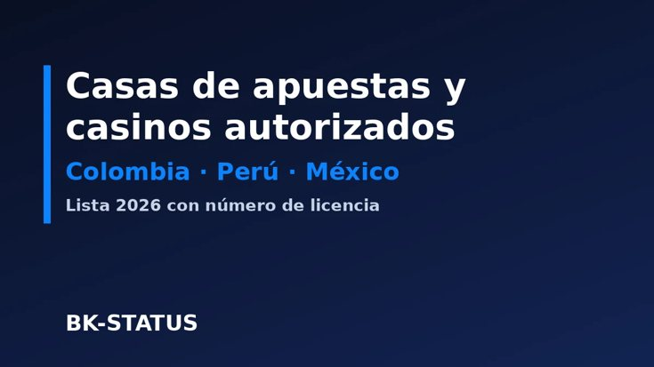

# Operadores de juego autorizados en Colombia, Perú y México

Datos abiertos, en CSV, con los operadores de juego en línea que figuran como autorizados en tres países de Latinoamérica. Sirven para comprobar una licencia o para analizar el mercado sin tener que reunir tres fuentes con formatos distintos.

Versión para leer en el navegador: [página de este proyecto](https://akaauntinsta-cell.github.io/operadores-autorizados-latam/).

## Archivos

| Archivo | País | Filas | Fuente | Consulta |
|---|---|---|---|---|
| [colombia.csv](colombia.csv) | Colombia | 16 | Dataset «Juegos Operados por Internet» de Coljuegos, en [datos.gov.co](https://www.datos.gov.co/) | 5 de noviembre de 2026 |
| [peru.csv](peru.csv) | Perú | 51 | Registro «Titulares de Autorización de Explotación» del [MINCETUR](https://www.gob.pe/mincetur) | 3 de noviembre de 2026 |
| [mexico.csv](mexico.csv) | México | 5 | Permisos declarados por los propios operadores; no hay registro público completo | noviembre de 2026 |

## Qué conviene saber antes de usarlos

- **Colombia:** el dataset indicaba como última actualización el 14 de marzo de 2025, así que puede no recoger renovaciones posteriores. La columna `nota` lo señala cuando lo sabemos.
- **Perú:** el registro tenía 95 autorizaciones. Aquí están agrupadas por empresa y dominio, por eso hay 51 filas. Seis figuraban con suspensión temporal.
- **México:** no hemos encontrado un registro público y completo. Las filas recogen lo que declara cada operador, y una de ellas tiene fuentes contradictorias. No equivalen a una verificación oficial.

Figurar aquí no es una recomendación: solo constata que el operador aparece como autorizado en esa fecha. Las suspensiones, renovaciones y bajas ocurren entre una actualización y otra, así que comprueba siempre el registro oficial antes de tomar una decisión.

## Origen

Estos archivos se extraen de la [lista de operadores autorizados de BK-STATUS](https://bk-status.com/blog/operadores-autorizados-colombia-peru-mexico/), que se revisa cada mes y explica la metodología. [BK-STATUS](https://bk-status.com/) es un rating independiente de operadores legales en estos tres países.

¿Ves un error? Abre un issue indicando la fuente oficial.

*El juego puede causar adicción. Solo mayores de 18 años. Si te está afectando, consulta la [página de juego responsable](https://bk-status.com/juego-responsable/).*
